

  <h1>🚀 TP5 : Environnements de lab reproductibles avec Vagrant</h1>
  
<strong>Combinaison de Vagrant (création des VMs) et Ansible (configuration)</strong>

  
  
  
  
  

 

> **Objectif :** Créer un environnement de développement reproductible et léger. Le projet utilise un `Vagrantfile` multi-machines pour créer 2 VMs Ubuntu, puis utilise le provisioner Ansible pour installer Docker, Portainer, Jenkins et déployer l'application web conteneurisée (créée au TP4).

   
  📄 <strong><a href="./tp5_vagrant.pdf">Télécharger le rapport complet du TP5 (PDF)</a></strong>
    

---

## 🛠️ Partie 0 : Prérequis et Installation

### Vérification de la Virtualisation Imbriquée
Pour que VirtualBox puisse fonctionner à l'intérieur de la VM de lab, la virtualisation imbriquée doit être activée. Le processeur expose bien les extensions (`vmx` / `svm`).

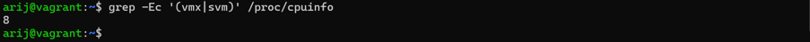

### Installation des Outils
Installation de VirtualBox, Ansible et Vagrant (via le dépôt HashiCorp) sur la VM de lab.

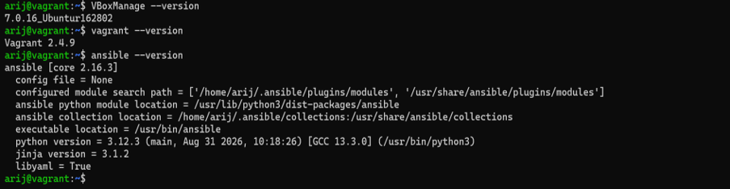

---

## 🧪 Partie 1 : Démo Vagrant (Machine unique)

Création d'une première VM simple pour valider le fonctionnement de Vagrant. Le `Vagrantfile` synchronise un dossier local `web/` avec Apache et redirige le port 80 vers le port 8080.

### Le Vagrantfile de la démo
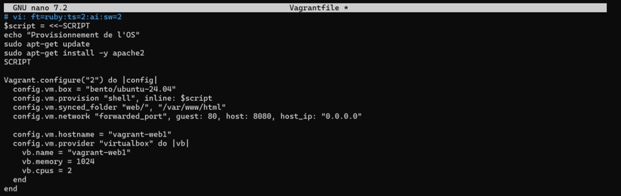

### Lancement de la VM
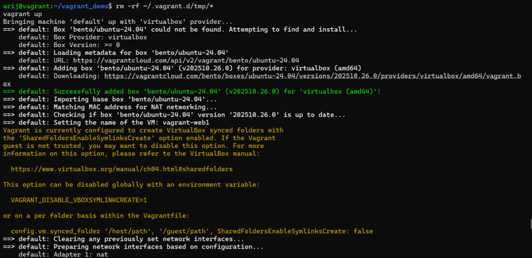

### Test du site web
Le site est accessible depuis le navigateur de la machine hôte sur le port 8080.

---

## 🌐 Partie 2 : Le Lab complet (Multi-machines)

Création d'un environnement avec **2 machines virtuelles** (`web1` et `web2`) sur un réseau privé (`private_network`). Chaque machine est configurée automatiquement via Ansible, qui réutilise les rôles du TP4.

### Préparation du projet
Récupération des rôles Ansible et des fichiers Docker depuis le dépôt du TP4.

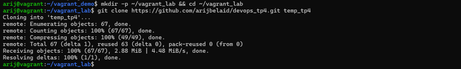

### Le Playbook Ansible
Le playbook fait appel aux 3 rôles : `docker_portainer_install`, `jenkins_install` et `container_deployment`.

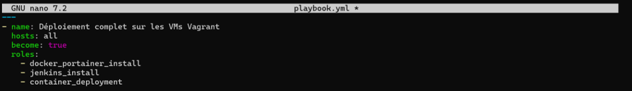

### Provisionnement avec Ansible
Exécution réussie des rôles sur les deux machines (`web1` et `web2`) avec `failed=0`.

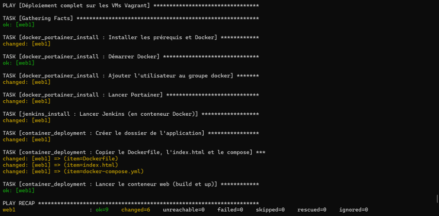
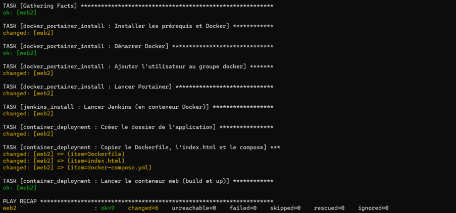

### État des machines
Les deux VMs sont lancées avec succès par Vagrant et sont en cours d'exécution.

### Services déployés
Les services sont accessibles depuis le navigateur de la machine hôte :
*   **Web1** : Site web (`8082`), Portainer (`9000`), Jenkins (`8081`)
*   **Web2** : Site web (`18082`), Portainer (`19000`), Jenkins (`18081`)

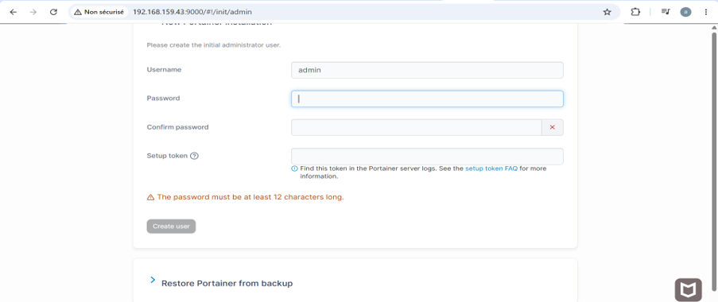
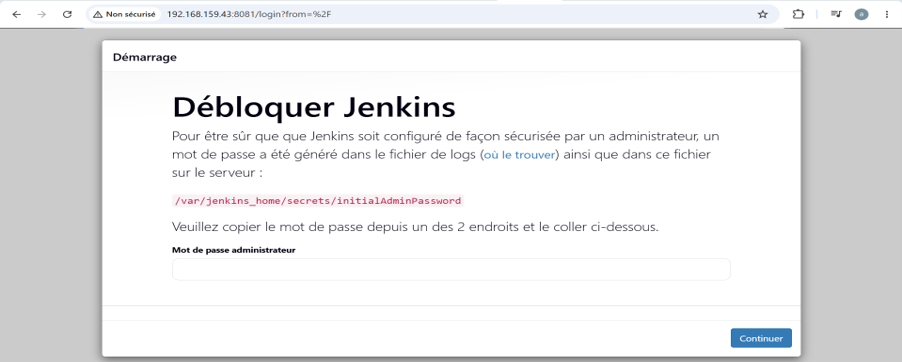

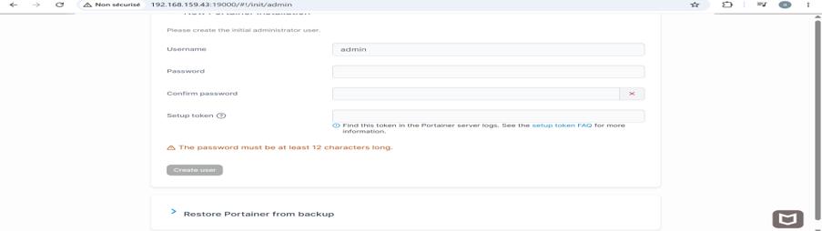

---
*Réalisé par [Arij Belaid](https://github.com/arijbelaid) dans le cadre du cours de DevOps.*
